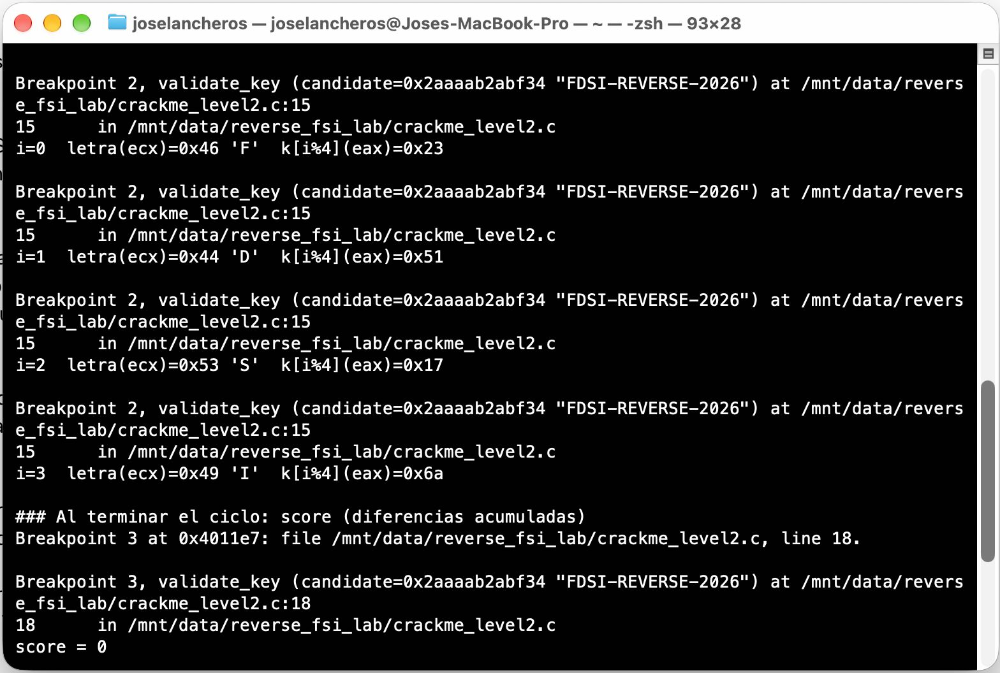
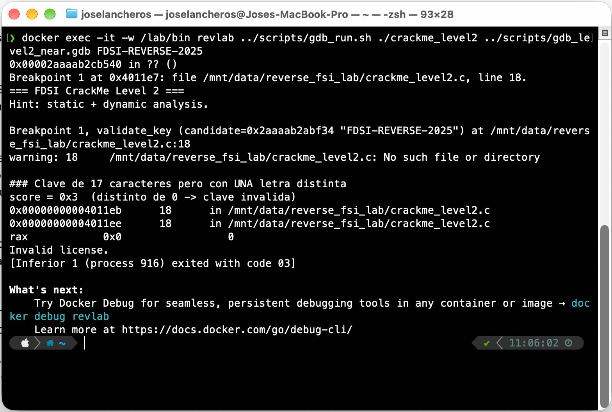

# Confirmación dinámica con GDB

**Binario:** `crackme_level2`
**Objetivo:** demostrar **en ejecución** que el análisis estático del Nivel 2 es correcto: la función `validate_key` devuelve `0` con una clave incorrecta y `1` con `FDSI-REVERSE-2026`.

---

## 0. Nota sobre el entorno (Mac Apple Silicon)

Los binarios son x86-64 y los ejecutamos en Docker emulando x86 sobre un Mac ARM. En ese entorno, GDB **no puede pausar** el programa de forma directa (`ptrace` falla con `Couldn't get registers: Input/output error`).

**Solución:** ejecutamos el binario con **QEMU** en modo depuración (`qemu-x86_64 -g 1234`). QEMU abre un "puerto de depuración" y GDB se conecta a él con `target remote :1234`. A partir de ahí los comandos de GDB son los mismos que en Kali o Ubuntu.

```bash
# scripts/gdb_run.sh
qemu-x86_64 -g 1234 ./crackme_level2 <clave> &
gdb -q -batch -x <comandos.gdb> ./crackme_level2
```

En Kali o Ubuntu x86-64 nativo bastaría con `gdb ./crackme_level2` y luego `run <clave>`.

**Pequeño glosario:**
- **Breakpoint:** un "punto de pausa"; el programa se detiene al llegar a esa línea o instrucción.
- **Registro:** una "cajita" de memoria muy rápida dentro del procesador.
  - `RDI`: guarda el **primer parámetro** que recibe una función.
  - `RAX`: guarda el **valor que devuelve** una función.
- **`finish`:** deja terminar la función actual y muestra lo que devolvió.

---

## Prueba 1 — Clave incorrecta corta (`AAAA`)

Comandos: [`scripts/gdb_level2_bad.gdb`](../../../scripts/gdb_level2_bad.gdb). Log completo: [`gdb_logs/gdb_bad.log`](gdb_logs/gdb_bad.log)

```text
(gdb) break validate_key
Breakpoint 1 at 0x401162
(gdb) continue
Breakpoint 1, validate_key (candidate=0x2aaaab2abf40 "AAAA")

(gdb) info registers rdi
rdi            0x2aaaab2abf40
(gdb) x/s $rdi
0x2aaaab2abf40:	"AAAA"                  <-- RDI apunta a lo que escribió el usuario

(gdb) break *0x401176                   <-- justo después de strlen
(gdb) continue
(gdb) x/gx $rbp-0x18
0x...:	0x0000000000000011              <-- largo esperado = 17
(gdb) info registers rax
rax            0x4                 4    <-- largo real de "AAAA" = 4

(gdb) finish
Value returned is $1 = 0                <-- validate_key devuelve 0 (falso)
rax            0x0                 0
Invalid license.
[Inferior 1 exited with code 03]
```

**Qué demuestra:** el primer filtro es el **largo**. 4 no es igual a 17, así que la función sale de inmediato con `0`, sin revisar ninguna letra. Esto coincide con `cmp [rbp-0x18],rax` / `je` del análisis estático.

---

## Prueba 2 — Clave candidata correcta (`FDSI-REVERSE-2026`)

Comandos: [`scripts/gdb_level2_good.gdb`](../../../scripts/gdb_level2_good.gdb). Log completo: [`gdb_logs/gdb_good.log`](gdb_logs/gdb_good.log)

### 2.1 Los arreglos `k` y `expected` existen en memoria tal como los leímos en `.rodata`

```text
(gdb) x/4xb  0x40208b
0x40208b <k.1>:	        0x23	0x51	0x17	0x6a
(gdb) x/17xb 0x402090
0x402090 <expected.0>:	0x65	0x15	0x44	0x23	0x0e	0x03	0x52	0x3c
0x402098 <expected.0+8>:	0x66	0x03	0x44	0x2f	0x0e	0x63	0x27	0x58
0x4020a0 <expected.0+16>:	0x15
```

### 2.2 Pausa en la instrucción `xor eax,ecx` (0x4011b9), dentro del ciclo

En cada vuelta mostramos: el índice `i`, la letra del usuario (`ECX`) y el byte de `k` que se usa (`EAX`):

```text
i=0  letra(ecx)=0x46 'F'  k[i%4](eax)=0x23
i=1  letra(ecx)=0x44 'D'  k[i%4](eax)=0x51
i=2  letra(ecx)=0x53 'S'  k[i%4](eax)=0x17
i=3  letra(ecx)=0x49 'I'  k[i%4](eax)=0x6a
```

Comprobación a mano: `0x46 XOR 0x23 = 0x65`, que es justo `expected[0]`. ✅
Además se ve que `k` avanza `23 → 51 → 17 → 6a`; en `i=4` vuelve a `0x23` (ciclo de 4).

### 2.3 Al terminar el ciclo (0x4011e7): el acumulador `score`

```text
score = 0                                <-- ninguna diferencia
(gdb) finish
Value returned is $1 = 1                 <-- validate_key devuelve 1 (verdadero)
rax            0x1                 1
License accepted.
FLAG{ghidra_plus_gdb}
[Inferior 1 exited normally]
```



---

## Prueba 3 — Largo correcto, una sola letra distinta (`FDSI-REVERSE-2025`)

Comandos: [`scripts/gdb_level2_near.gdb`](../../../scripts/gdb_level2_near.gdb). Log completo: [`gdb_logs/gdb_near.log`](gdb_logs/gdb_near.log)

```text
Breakpoint 1, validate_key (candidate=... "FDSI-REVERSE-2025")
score = 0x3  (distinto de 0 -> clave invalida)
rax            0x0                 0
Invalid license.
[Inferior 1 exited with code 03]
```

**Por qué `score = 0x3`:** la última letra esperada es `'6'` (0x36) y escribimos `'5'` (0x35). La diferencia, calculada con XOR, es `0x36 XOR 0x35 = 0x03`. Ese `3` queda "pegado" en `score` gracias al `OR`, así que el resultado final ya no puede ser 0.



---

## Relación registros / instrucciones ↔ pseudocódigo de Ghidra

| Pseudocódigo | Instrucción | Qué vimos en GDB |
|---|---|---|
| `candidate` (parámetro) | `mov [rbp-0x28],rdi` | `RDI` → `"AAAA"` / `"FDSI-REVERSE-2026"` |
| `largo = 17` | `mov [rbp-0x18],0x11` | `0x11` en `rbp-0x18` |
| `strlen(candidate) != largo` | `call strlen` / `cmp` / `je` | `RAX = 4` contra `17` → sale con 0 |
| `candidate[i] ^ k[i % 4]` | `and eax,0x3` / `xor eax,ecx` | `ECX = 'F'`, `EAX = 0x23` … |
| `diferencias |= expected[i] ^ t` | `xor al,[rbp-0x19]` / `or [rbp-0x4],eax` | `score = 0` (buena) / `0x3` (casi) |
| `return diferencias == 0` | `cmp [rbp-0x4],0` / `sete al` | `RAX = 1` (buena) / `RAX = 0` (malas) |

## ¿Qué confirmó GDB que el análisis estático no demostraba?

1. Que **nuestra lectura del código es la que realmente se ejecuta**: el largo 17, el ciclo de 4 bytes de `k` y el XOR se ven con valores reales en los registros.
2. Que la función **devuelve 1 solo con nuestra clave**, y que una diferencia mínima (una letra) ya basta para devolver 0.
3. El análisis estático nos dio una **hipótesis**; GDB la convirtió en una **prueba** con evidencia observable.
