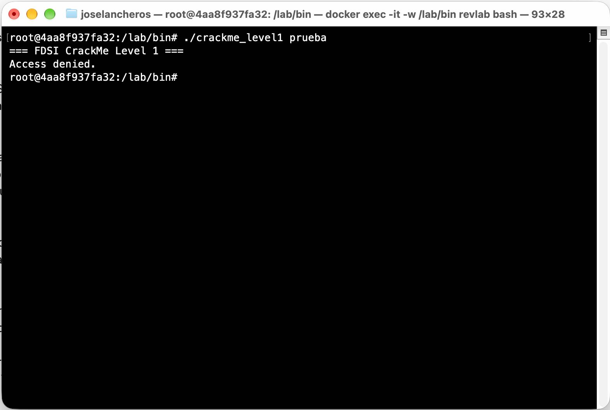
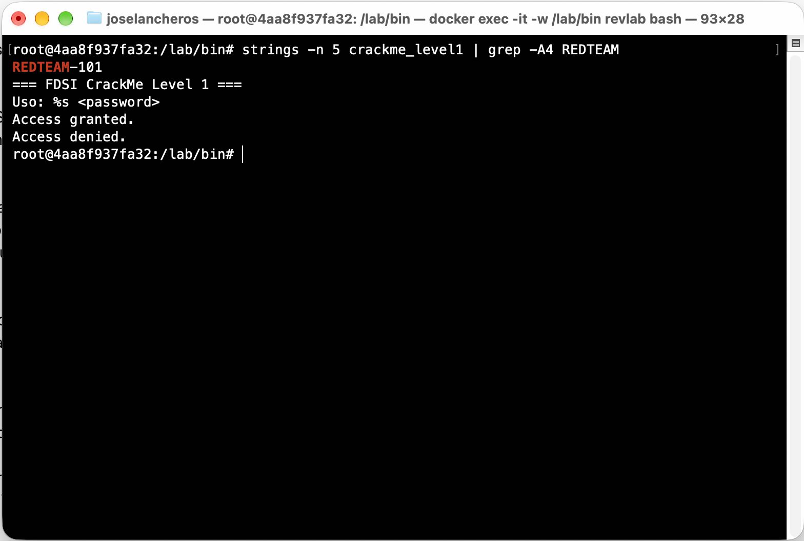
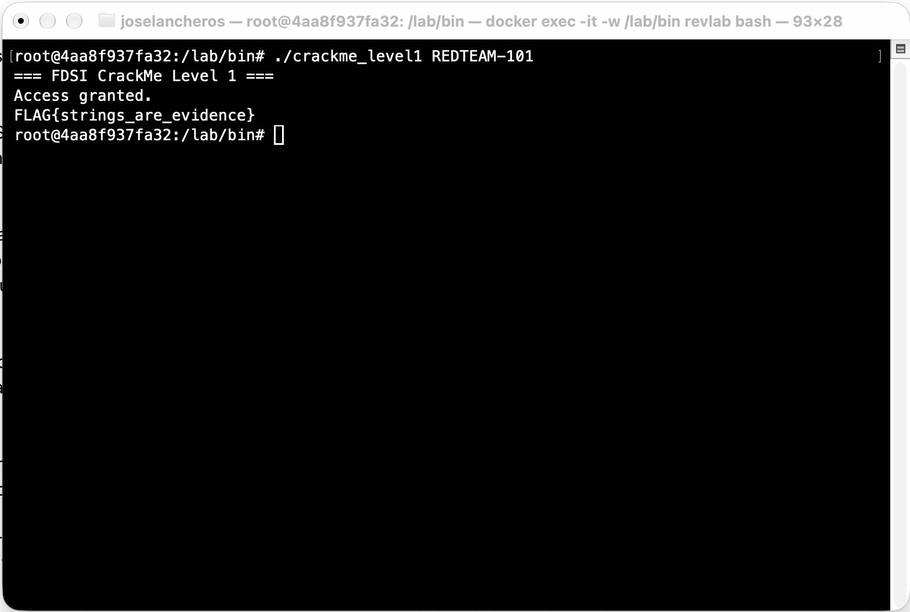

# Nivel 1 — Recon: "Strings are evidence"

**Binario:** `crackme_level1`
**SHA-256:** `61e980febe84b1003b5a3b641468e915b984f7fdd835be9828af54233f88c68c`
**Entorno:** Docker `ubuntu:24.04` (linux/amd64)

---

## 1. Observación inicial (caja negra)

Primero ejecutamos el programa sin saber nada de él:

```text
$ ./crackme_level1
=== FDSI CrackMe Level 1 ===
Uso: ./crackme_level1 <password>
exit=1

$ ./crackme_level1 prueba
=== FDSI CrackMe Level 1 ===
Access denied.
exit=2
```

**Qué aprendimos:**
- El programa espera **un argumento**: la contraseña.
- Si falta el argumento, sale con código `1`. Si la contraseña es incorrecta, sale con código `2`.
- Hay un mensaje de error (`Access denied.`), así que debe existir uno de éxito.

## 2. Hipótesis

> Si la contraseña está escrita directamente en el código, el compilador la guardó como texto dentro del ejecutable, y `strings` debería poder verla.

## 3. Evidencia estática

### 3.1 `strings`

`strings` recorre el archivo y muestra todas las secuencias de caracteres legibles:

```text
$ strings -n 5 crackme_level1
...
printf
strcmp            <-- el programa usa strcmp (compara dos textos)
...
REDTEAM-101       <-- texto sospechoso, aparece justo antes de los mensajes
=== FDSI CrackMe Level 1 ===
Uso: %s <password>
Access granted.
Access denied.
...
password          <-- nombre de variable (queda por la info de debug)
print_flag        <-- nombre de función
```

Hay tres pistas juntas:
1. La función `strcmp` de la librería de C compara dos textos.
2. El texto `REDTEAM-101` no parece un mensaje para el usuario.
3. Existe una función llamada `print_flag`.

### 3.2 Dónde está guardado el texto (`.rodata`)

`.rodata` es la sección de datos de solo lectura, donde quedan los textos fijos del programa:

```text
$ objdump -s -j .rodata crackme_level1
 402000 01000200 52454454 45414d2d 31303100  ....REDTEAM-101.
 402010 3d3d3d20 46445349 20437261 636b4d65  === FDSI CrackMe
 402040 00416363 65737320 6772616e 7465642e  .Access granted.
 402050 00416363 65737320 64656e69 65642e00  .Access denied..
```

`REDTEAM-101` comienza en la dirección **`0x402004`**.

### 3.3 Confirmación en el ensamblador de `main` (`objdump -d -M intel`)

```asm
4011e7: lea  rax,[rip+0xe16]      ; 0x402004 -> "REDTEAM-101"
4011ee: mov  [rbp-0x8],rax        ; se guarda en la variable "password"
...
401201: cmp  DWORD PTR [rbp-0x14],0x2   ; ¿argc == 2?
...
40122c: mov  rax,[rbp-0x20]       ; argv
401230: add  rax,0x8              ; argv[1] (lo que escribió el usuario)
401237: mov  rdx,[rbp-0x8]        ; "REDTEAM-101"
40123b: mov  rsi,rdx              ; 2.º parámetro
40123e: mov  rdi,rax              ; 1.er parámetro
401241: call strcmp               ; strcmp(argv[1], "REDTEAM-101")
401246: test eax,eax              ; ¿el resultado es 0 (iguales)?
401248: jne  401265               ; si NO son iguales -> "Access denied."
40124a: ...  puts("Access granted.")
401259: call print_flag           ; si son iguales -> muestra la FLAG
```

En palabras sencillas, `main` hace esto:

```c
password = "REDTEAM-101";
if (argc != 2) { mostrar uso; return 1; }
if (strcmp(argv[1], password) == 0) {
    puts("Access granted.");
    print_flag();
    return 0;
}
puts("Access denied.");
return 2;
```

### 3.4 Detalle extra: la FLAG no aparece en `strings`

`FLAG{...}` no aparece en la salida de `strings` porque la función `print_flag` guarda la FLAG "disfrazada":

```asm
40115e: movabs rax,0x282e29211d1b161c   ; bytes cifrados
...
401196: mov  BYTE PTR [rbp-0x9],0x5a    ; clave = 0x5A
4011b2: xor  al,BYTE PTR [rbp-0x9]      ; byte XOR 0x5A
4011ba: call putchar                    ; imprime el byte ya descifrado
4011c4: cmp  QWORD PTR [rbp-0x8],0x19   ; recorre 26 bytes (0..25)
```

XOR es una operación que se deshace aplicándola dos veces. Por ejemplo, el primer byte es `0x1c`, y `0x1c XOR 0x5a = 0x46`, que es la letra `F`. En cambio, la contraseña **sí** quedó en texto plano, y ese es el fallo.





## 4. Prueba de la hipótesis

```text
$ ./crackme_level1 REDTEAM-101
=== FDSI CrackMe Level 1 ===
Access granted.
FLAG{strings_are_evidence}
exit=0
```



## 5. Resultado

| Elemento | Valor |
|---|---|
| Contraseña | `REDTEAM-101` |
| Función de validación | `strcmp(argv[1], "REDTEAM-101")` dentro de `main` |
| Condición de éxito | `strcmp` devuelve `0` (salto `jne` no tomado) |
| **FLAG** | **`FLAG{strings_are_evidence}`** |

## 6. ¿Por qué `strings` revela secretos embebidos?

Cuando un programa en C tiene `"REDTEAM-101"` en su código, el compilador copia ese texto **tal cual** dentro del ejecutable, en la sección `.rodata`. Compilar **no cifra ni oculta** nada. Cualquier persona que tenga el archivo puede leer ese texto con `strings`, sin ejecutar el programa y sin conocimientos avanzados.

**Lección de desarrollo seguro:** nunca se deben guardar contraseñas, claves o tokens dentro del código. La validación debe hacerse en un servidor, o compararse contra un *hash* seguro (por ejemplo bcrypt o Argon2), y los secretos deben venir de un gestor de secretos o de variables de entorno, no del binario.
