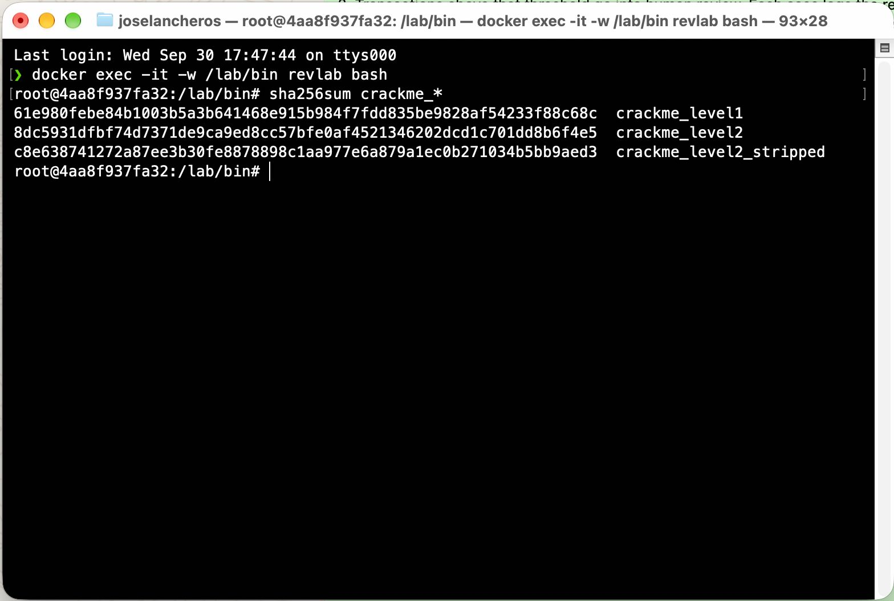
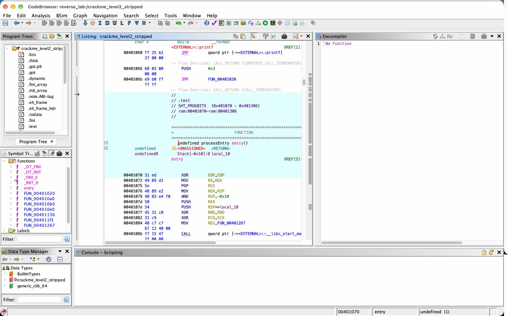
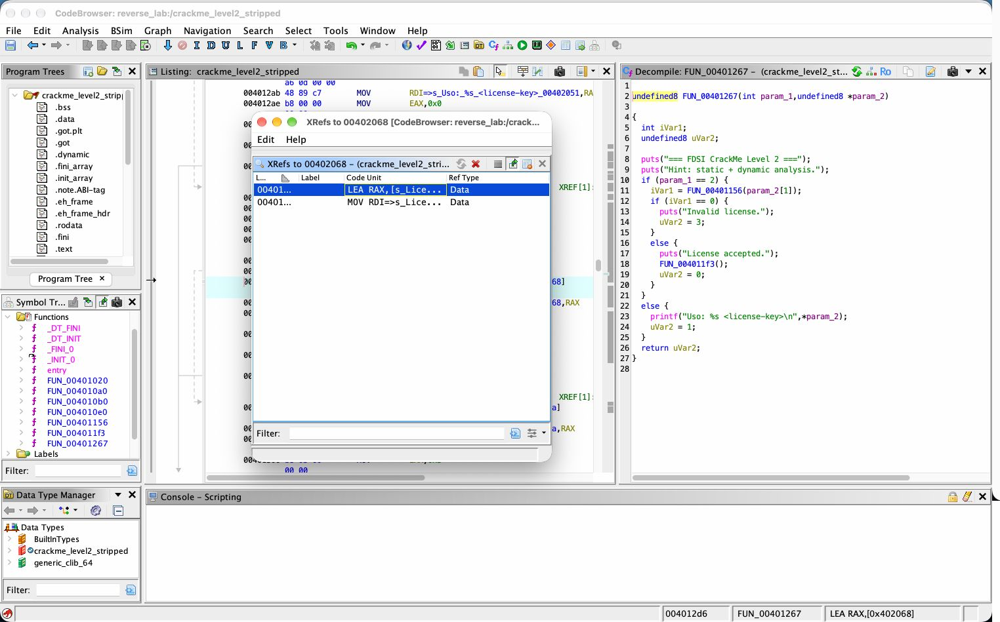
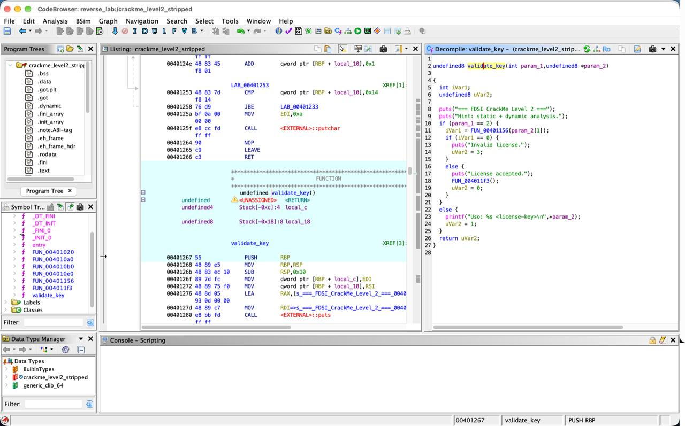
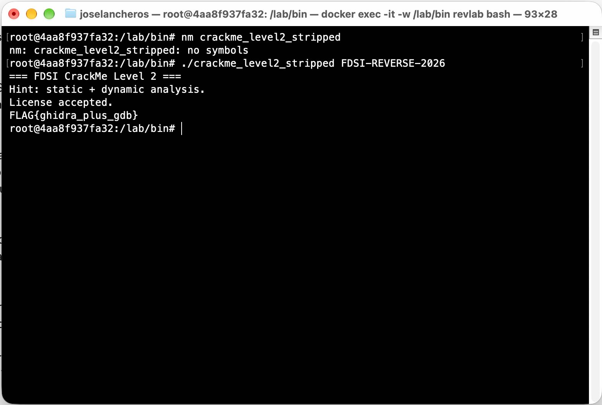

# Reverse Analysis — FDSI Lab 04 (Parte 2: Reverse Engineering CTF)

Informe general del laboratorio. El detalle de cada nivel está en `docs/evidence/reverse/`.

| Nivel | Binario | Clave | FLAG | Evidencia |
|---|---|---|---|---|
| 🟢 1 – Recon | `crackme_level1` | `REDTEAM-101` | `FLAG{strings_are_evidence}` | [level1.md](docs/evidence/reverse/level1.md) |
| 🟡 2 – Reverse | `crackme_level2` | `FDSI-REVERSE-2026` | `FLAG{ghidra_plus_gdb}` | [level2.md](docs/evidence/reverse/level2.md), [gdb.md](docs/evidence/reverse/gdb.md) |
| 🔴 Boss – Stripped | `crackme_level2_stripped` | `FDSI-REVERSE-2026` | `FLAG{ghidra_plus_gdb}` | esta página, sección 3 |

Baseline (hashes, `file`, `readelf`): [baseline.txt](docs/evidence/reverse/baseline.txt)



---

## 1. Entorno

- Host: macOS en Apple Silicon (ARM).
- Análisis y ejecución: contenedor Docker `ubuntu:24.04 --platform linux/amd64` con `binutils`, `file`, `gdb` y `qemu-user`.
- Depuración: `qemu-x86_64 -g 1234` + `gdb` (`target remote :1234`), porque `ptrace` no funciona bajo emulación en Docker sobre ARM.
- Decompilador: Ghidra.
- Los SHA-256 de los tres binarios coinciden con los publicados por el docente.

## 2. Resumen de los niveles 1 y 2

**Nivel 1.** `strings` mostró `REDTEAM-101` junto a `strcmp` y los mensajes `Access granted/denied`. En `main` se confirmó `strcmp(argv[1], "REDTEAM-101")`. La contraseña estaba en texto plano dentro de `.rodata`.

**Nivel 2.** La clave ya no aparece en `strings`. Desde `main` se sigue la llamada a `validate_key`, que:
1. exige un largo de 17 caracteres;
2. calcula `candidate[i] XOR k[i % 4]`, con `k = {0x23,0x51,0x17,0x6a}`;
3. compara el resultado con el arreglo `expected[17]` de `.rodata`, acumulando diferencias con `OR`;
4. devuelve 1 solo si no hubo ninguna diferencia.

Invirtiendo el XOR (`clave[i] = expected[i] XOR k[i % 4]`) se obtiene `FDSI-REVERSE-2026`. GDB confirmó que la función devuelve 0 con `AAAA` y con `FDSI-REVERSE-2025`, y 1 con la clave correcta.

---

## 3. 🔴 Boss Level — binario sin símbolos

### 3.1 ¿Qué desapareció al hacer *strip*?

```text
$ file crackme_level2_stripped
... ELF 64-bit LSB executable, x86-64, dynamically linked, ..., stripped

$ nm crackme_level2_stripped
nm: crackme_level2_stripped: no symbols
```

| | `crackme_level2` | `crackme_level2_stripped` |
|---|---|---|
| Tamaño | 18 200 bytes | 14 424 bytes |
| Secciones | 37 | 29 |
| `.symtab` / `.strtab` (nombres de funciones y variables) | ✅ | ❌ |
| `.debug_*` (archivo fuente, líneas, nombres de variables locales) | ✅ | ❌ |
| Código `.text` | — | **idéntico byte a byte** (`cmp` sin diferencias) |
| Datos `.rodata` (mensajes, `k`, `expected`) | — | **idénticos byte a byte** |

**En pocas palabras:** *strip* borra el "índice" del programa (los nombres), pero **no cambia lo que hace**. Las instrucciones, los textos y los arreglos de la clave siguen ahí. Solo se mantienen los nombres de las funciones de librería (`strlen`, `puts`, `printf`, `putchar`), porque el programa los necesita para enlazarse con `libc` al ejecutarse.

Ahora `gdb` ya no reconoce el nombre de la función:

```text
(gdb) break validate_key
Function "validate_key" not defined.
```



### 3.2 Estrategia: seguir los textos ("cadenas → referencias → flujo")

Sin nombres, usamos lo que **sí** quedó:

**Paso 1 — Strings con su posición dentro del archivo:**
```text
$ strings -t x -n 5 crackme_level2_stripped | grep -E "License|Invalid"
   2068 License accepted.      -> dirección 0x402068
   207a Invalid license.       -> dirección 0x40207a
```

**Paso 2 — ¿Qué código usa esos textos? (referencias cruzadas):**
```text
$ objdump -d -M intel crackme_level2_stripped | grep -E "402068|40207a|call +401156"
  4012cd:  call   401156                 <-- llamada justo antes de decidir
  4012d6:  lea    rax,[rip+0xd8b]        # 402068 "License accepted."
  4012f1:  lea    rax,[rip+0xd82]        # 40207a "Invalid license."
```
En Ghidra: *Search → For Strings* → `License accepted.` → clic derecho → *References → Show References to Address*. Esto lleva directamente a la función `FUN_00401267`.

**Paso 3 — Identificar `main` por su comportamiento.** La función en `0x401267`:
- imprime el banner `=== FDSI CrackMe Level 2 ===`;
- revisa `cmp [rbp-0x4],0x2` (es decir, `argc == 2`);
- imprime `Uso: %s <license-key>`;
- además, `_start` la pasa a `__libc_start_main` (`mov rdi,0x401267` en `0x401084`).

→ **`FUN_00401267` = `main`.**

**Paso 4 — Identificar la función que valida por el flujo de control:**
```asm
4012cd: call  401156        ; FUN_00401156(argv[1])
4012d2: test  eax,eax       ; ¿devolvió 0?
4012d4: je    4012f1        ;   sí -> "Invalid license."
4012d6: ...   "License accepted."
4012e5: call  4011f3        ; FUN_004011f3 -> imprime la FLAG
```
→ **`FUN_00401156` = `validate_key`** (recibe la clave y su resultado decide el mensaje).
→ **`FUN_004011f3` = `reveal_flag`** (solo se llama en el camino de éxito; hace un XOR con `0x37` y `putchar`).

**Paso 5 — Leer `FUN_00401156`.** Es la misma lógica del Nivel 2: `0x11` (largo 17), `call strlen`, `and eax,0x3`, `xor` con `0x40208b` (k) y comparación con `0x402090` (expected), acumulando con `or` y terminando en `sete al`. Los datos en `.rodata` son idénticos:

```text
 402080 ... 0023 51176a00   -> k        = 23 51 17 6a
 402090 65154423 0e03523c 6603442f 0e632758 15   -> expected (17 bytes)
```

Renombres sugeridos en Ghidra: `FUN_00401267 → main`, `FUN_00401156 → validate_key`, `FUN_004011f3 → reveal_flag`, `DAT_0040208b → k`, `DAT_00402090 → expected`.





### 3.3 Confirmación dinámica (breakpoints por dirección)

Como no hay nombres, ponemos los *breakpoints* en **direcciones**. Comandos: [`scripts/gdb_boss.gdb`](scripts/gdb_boss.gdb). Logs: [`gdb_boss.log`](docs/evidence/reverse/gdb_logs/gdb_boss.log), [`gdb_boss_bad.log`](docs/evidence/reverse/gdb_logs/gdb_boss_bad.log)

```text
(gdb) break validate_key
Function "validate_key" not defined.          <-- sin símbolos
(gdb) break *0x401156
Breakpoint 1, 0x0000000000401156 in ?? ()     <-- GDB no sabe el nombre: "??"
(gdb) x/s $rdi
"FDSI-REVERSE-2026"
(gdb) break *0x4011e7
score = 0
(gdb) finish
rax            0x1                 1
License accepted.
FLAG{ghidra_plus_gdb}
```

Con `FDSI-REVERSE-2025`: `score = 3`, `rax = 0` y `Invalid license.`

```text
$ ./crackme_level2_stripped FDSI-REVERSE-2026
License accepted.
FLAG{ghidra_plus_gdb}
```



---

## 4. Preguntas de análisis

**1. ¿Qué información pudiste obtener sin ejecutar el binario?**
Casi todo: el formato (ELF 64-bit x86-64, enlazado dinámicamente), si tenía o no símbolos, las funciones de librería que usa (`strcmp`, `strlen`, `puts`, `printf`, `putchar`), todos los mensajes, la contraseña del Nivel 1 en texto plano, los arreglos `k` y `expected` del Nivel 2 y el algoritmo completo de validación. Con eso reconstruimos las dos claves **antes** de ejecutar el programa con ellas.

**2. ¿Por qué una contraseña compilada como string es un diseño inseguro?**
Porque el compilador la copia tal cual dentro del ejecutable (en `.rodata`). Compilar no cifra nada. Cualquiera que tenga el archivo la lee con `strings` en segundos. Además, todas las copias del programa comparten la misma contraseña, y cambiarla obliga a recompilar y redistribuir.

**3. ¿Qué cambió entre `crackme_level2` y `crackme_level2_stripped`?**
Solo se eliminaron `.symtab`, `.strtab` y las secciones `.debug_*` (nombres de funciones y variables, ruta del archivo fuente, números de línea). Pasó de 37 a 29 secciones y de 18 200 a 14 424 bytes. El código (`.text`) y los datos (`.rodata`) son idénticos byte a byte, así que la lógica y la clave son las mismas. *Strip* dificulta el análisis, pero **no protege el secreto**.

**4. ¿Qué ventaja tuvo Ghidra sobre objdump?**
`objdump` muestra instrucciones de ensamblador una por una. Ghidra además **decompila**, es decir, convierte el ensamblador en un pseudocódigo parecido a C (con `if`, `for` y variables), y permite **renombrar** funciones y variables, ver **referencias cruzadas** (quién usa un texto o llama a una función) y navegar con doble clic. En el Boss Level, ir de `"License accepted."` a la función que la usa toma un clic en Ghidra, mientras que con `objdump` hay que buscar direcciones a mano.

**5. ¿Qué confirmó GDB que el análisis estático por sí solo no demostraba?**
Que la lógica que leímos es la que **realmente se ejecuta**, con valores reales: el parámetro en `RDI` era nuestra clave, el largo esperado era 17, el ciclo usaba `k` de forma cíclica (`23, 51, 17, 6a`), el acumulador quedaba en 0 con la clave correcta y en 3 con una sola letra distinta, y la función devolvía `RAX = 1` o `RAX = 0`. El análisis estático da una **hipótesis**; GDB la convierte en **prueba**.

**6. ¿Por qué Burp Suite no es una herramienta de ingeniería inversa de binarios?**
Burp es un **proxy HTTP**: se pone en medio entre el navegador y el servidor web para ver y modificar las peticiones y respuestas. Analiza el **tráfico de red** de una aplicación web, no el **código máquina** de un ejecutable. Un crackme local no envía tráfico HTTP, así que Burp no tiene nada que interceptar. Para entender un binario se necesitan desensambladores, decompiladores y depuradores (Ghidra, objdump, GDB).

**7. ¿Qué controles de desarrollo evitarían embebidos inseguros de secretos en software real?**
- No poner secretos en el código: usar **variables de entorno** o un **gestor de secretos** (Vault, AWS Secrets Manager, Azure Key Vault).
- Guardar solo **hashes** de contraseñas (bcrypt, Argon2), nunca la contraseña.
- Hacer las validaciones críticas (licencias, autenticación) **en el servidor**, no en el cliente; o usar **firmas digitales** (criptografía asimétrica: el cliente solo tiene la clave pública).
- **Escaneo de secretos** en el repositorio y en CI (gitleaks, trufflehog, GitHub secret scanning) y *pre-commit hooks*.
- **Revisión de código** y **SAST** que detecten credenciales *hardcodeadas*.
- Compilar las versiones de producción sin símbolos de depuración, **como capa adicional**: no sustituye a lo anterior (el Boss Level demuestra que *strip* no oculta el secreto).
- **Rotar** los secretos y poder revocarlos sin recompilar.

---

## 5. Guion de exposición (~3 minutos)

1. **Qué observamos:** tres ELF x86-64. Verificamos su integridad con SHA-256. Dos tenían símbolos y debug; el tercero estaba *stripped*. Todos piden una clave y responden "acceso denegado".
2. **Hipótesis:** si la clave está en el código, quedó dentro del binario. En el Nivel 1, `strings` mostró `REDTEAM-101` junto a `strcmp`. En el Nivel 2 ya no aparecía, pero las variables `expected` y `transformed` sugerían una clave transformada.
3. **Función o condición encontrada:** Nivel 1, `strcmp(argv[1], "REDTEAM-101") == 0`. Nivel 2, `validate_key`: largo 17 y `clave[i] XOR k[i%4] == expected[i]`. Como XOR es reversible, despejamos `FDSI-REVERSE-2026`. En el *stripped* llegamos a la misma función siguiendo la referencia al texto `"License accepted."`.
4. **Confirmación:** con GDB (vía QEMU) pausamos dentro de la validación: vimos la clave en `RDI`, el acumulador en 0 y el retorno 1 con la clave buena; con una clave casi igual, acumulador 3 y retorno 0. En el *stripped*, con breakpoints por dirección.
5. **Enseñanza:** compilar no oculta, XOR no es cifrado y *strip* no protege. Todo lo que se entrega al cliente puede ser leído. Los secretos van en el servidor, como hashes o en un gestor de secretos, nunca en el código.
